<div align="center">

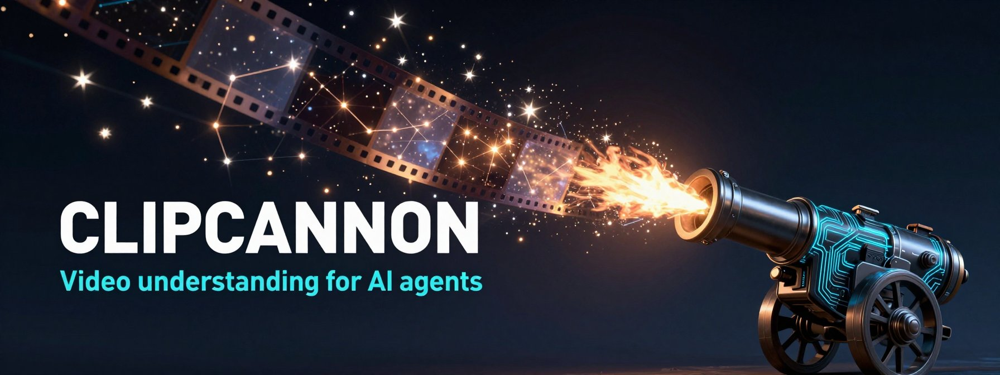

# ClipCannon

**Your AI agent can read, write, and reason. ClipCannon lets it *watch* and *listen*.**

A local MCP server that measures the frames, words, voices, emotions, and beats of a video through a panel of frozen AI instruments, then hands your agent **58 tools** to find the meaning, cut the edit, clone the voice, and render the result. All on your own GPU.

[](https://www.python.org/downloads/)
[](https://modelcontextprotocol.io)
[](#-the-58-tools)
[](#-the-23-stage-pipeline)
[](LICENSE)

[](https://www.youtube.com/@Leapableai)
[](https://x.com/ChrisRoyseAI1)
[](https://www.linkedin.com/in/christopher-royse-b624b596/)
[](https://www.clipcannon.com)

[Why](#-ai-agents-are-blind-to-video) · [How it sees](#-seven-senses-for-one-moment) · [Meaning](#-meaning-lives-between-the-senses) · [What the agent gets](#-what-your-agent-actually-sees) · [Constellations](#-teleological-constellations-identity-you-can-verify) · [Quick start](#-quick-start) · [Tools](#-the-58-tools) · [Results](#-measured-results) · [Research](#-research)

</div>

---

<div align="center">
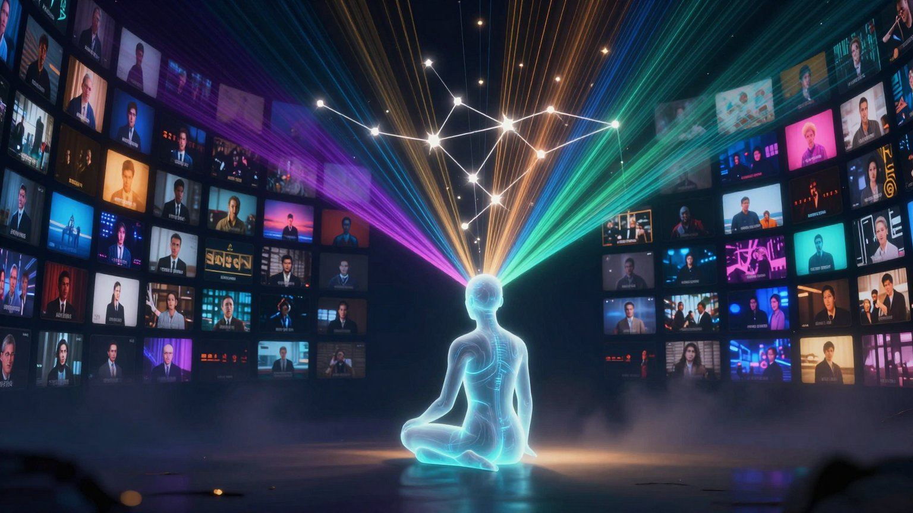
</div>

## 🎬 AI agents are blind to video

Hand a frontier model a two-hour podcast and ask for the five best 60-second clips. It can't do it. Not because it isn't smart enough, but because **it has no senses for video**. To a language model, an `.mp4` is an opaque blob. At best it gets a transcript, which is the words with the tone, the face, the laugh, the pause, the music, and the room stripped out.

Editors don't cut on words. They cut on the breath before the punchline, the moment the energy rises, the shot where the speaker leans in, the beat where the music drops. That information lives in the pixels and the waveform, and an agent can't reach it.

<div align="center">
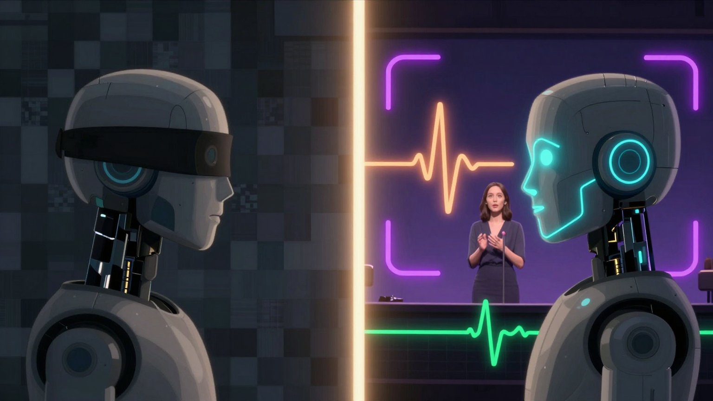
</div>

**ClipCannon is the missing sense organ.** You give it a video. It runs a 23-stage analysis pipeline on your GPU and turns the footage into a structured, searchable, measured record: who is speaking, what they are saying, how they are saying it, what is on screen, where the scenes change, where the laughs land, where the cuts are safe. Then it exposes that record to your agent through the [Model Context Protocol](https://modelcontextprotocol.io), along with the tools to act on it: edit, caption, crop, score, voice, render.

The agent stops guessing from a transcript and starts **reasoning over the actual reality of the footage**.

---

## 🔭 Seven senses for one moment

A single embedding of a video is a pointer, not an understanding. ClipCannon is built on a different idea, the one at the center of the **Calculus of Association** research program behind [Calyx](https://github.com/ChrisRoyse/Calyx): every moment of a video is measured by **several frozen instruments at once**, each trained on a different world of associations, and the readings are kept **separate**, never blended into one opaque vector.

<div align="center">

</div>

| # | Sense | Instrument (frozen) | Dims | What it perceives |
|---|---|---|---|---|
| 1 | 👁️ **Visual** | SigLIP-SO400M | 1,152 | face, pose, expression, lighting, composition |
| 2 | 💬 **Semantic** | Nomic Embed v1.5 | 768 | what is being said: topics, vocabulary, argument |
| 3 | 🔥 **Emotion** | wav2vec2-large (dimensional SER) | 1,024 | arousal, valence, and energy in the voice, independent of the words |
| 4 | 🗣️ **Speaker** | WavLM | 512 | who is talking: timbre, formants, vocal tract |
| 5 | 🎵 **Prosody** | custom acoustic features | 12 | the music of speech: F0 contour, energy, rate, pauses |
| 6 | 🧭 **Sentiment** | all-MiniLM-L6-v2 | 384 | sentence-level intent: assertive, questioning, emphatic |
| 7 | 🧬 **Voice identity** | ECAPA-TDNN | 192 | a compact speaker-verification fingerprint |

**Seven senses, 4,044 dimensions, measured on every moment.** Visual, semantic, emotion, and speaker readings live in sqlite-vec indexes for instant nearest-neighbor search; prosody lives in its own table; the full seven-modality constellation is assembled by `scripts/extract_all_embeddings.py`. Voice cloning verifies identity with a separate 2,048-d Qwen3 voice embedding.

Around that panel sit the structured signals an editor uses: word-level transcript (WhisperX large-v3), OCR of on-screen text, shot type, image quality, laughter and applause detection, beat tracking, music-vs-speech, source separation, pacing, profanity, and an LLM pass for story beats and chapters.

**Why frozen matters:** none of these models learn from your footage. They were trained by separate research groups for separate purposes, then frozen. So each reading is a *measurement*, not a guess: deterministic, comparable, and repeatable. The same frame always lands at the same coordinates. That's what turns an embedding model into an instrument, and it's what lets an agent trust, compare, and search what it measured.

---

## ✨ Meaning lives *between* the senses

Here is the core insight, and the reason ClipCannon is more than a pile of models.

Take a smile. The emotion instrument reads high valence. Is the speaker happy? Not necessarily. **Genuine happiness, sarcasm, and nervous laughter can share the same emotion reading.** What separates them is how that reading relates to the others: the prosody, the face, the words, the timing. Delight has smooth, matching prosody and a relaxed face. Sarcasm has flat prosody under positive words. Nerves show up as jittery pitch and a tense face.

<div align="center">
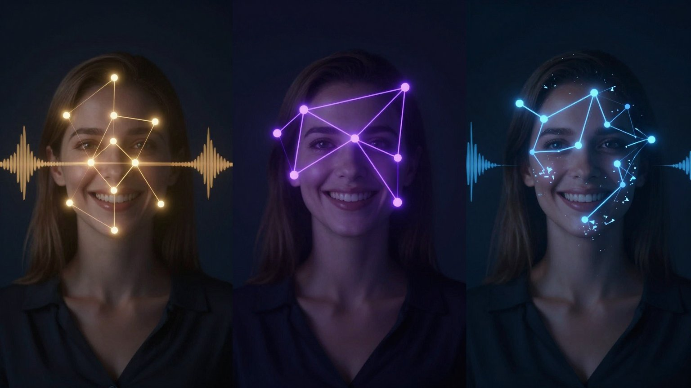
</div>

One reading is an **index**. The pattern across all of them, the **constellation**, is the **meaning**. Because ClipCannon keeps every instrument's reading separate and time-aligned, your agent can ask the question that matters: not "is this moment positive?" but **"where do the voice, the face, the words, and the energy all spike together?"** That's how the highlight scorer works: it combines emotion, reactions, semantics, visuals, quality, speaker, and pacing, and moments where the signals converge rise to the top.

Cross-checking is also a safeguard. If the face says happy but the voice says sad, the disagreement is detectable. If the words read as a question but the prosody reads as a statement, that's detectable too. One model can misread a moment; seven independent models misreading it the same way is far less likely.

> [!NOTE]
> ClipCannon was the first system in the **Calculus of Association** research program (N = 7 instruments). The same ideas were later scaled into [Context Graph](https://github.com/ChrisRoyse/contextgraph) (13 instruments over text and code) and [Calyx](https://github.com/ChrisRoyse/Calyx), an association-native database. See [Research](#-research) for the papers.

---

## 💎 One video, twelve thousand labeled facts

<div align="center">

</div>

The AI industry is running into a data wall: the stock of high-quality public text is close to used up, and training on model-generated data leads to model collapse. ClipCannon points at a third path, called **Derived Data Abundance**: instead of finding more data or synthesizing it, **measure the data you already have through many independent instruments.**

Here is what ClipCannon pulled out of a single **16-minute interview**:

| Modality | Samples | Dimensions | Values |
|---|---|---|---|
| Visual (SigLIP) | 1,725 | 1,152 | 1,987,200 |
| Emotion (wav2vec2) | 343 | 1,024 | 351,232 |
| FLAME facial expression | 3,477 | 100 | 347,700 |
| Speaker (WavLM) | 300 | 512 | 153,600 |
| Semantic (Nomic) | 200 | 768 | 153,600 |
| Sentiment (MiniLM) | 202 | 384 | 77,568 |
| Voice (ECAPA-TDNN) | 188 | 192 | 36,096 |
| Prosody | 188 | 12 | 2,256 |
| **Total** | | | **3,109,252** |

On top of that, the pipeline cut **2,362 training clips**, each automatically labeled for speaking vs. breathing, emotion, energy, visemes, scene and shot type, and speaker. In all: **12,000+ multi-dimensionally labeled data points from 16 minutes of footage**, with no human annotation.

With 7 instruments, every input carries up to **7 readings + 21 pairwise cross-terms = 28 structured signals**. And because the instruments are frozen measuring devices rather than generators, the derived data is grounded in real observations. It never feeds a model its own output, so it sits outside the recursion that causes model collapse.

---

## 🧠 What your agent actually sees

ClipCannon doesn't dump raw tensors on your model. Every tool returns **compact, decision-ready structure**, sized for a context window and written for a reasoner.

| Ask | Tool | What comes back |
|---|---|---|
| *"What is this video?"* | `get_editing_context` | Call this first. Counts and score ranges for every signal, each speaker's share of talk time, story beats, open loops, chapter boundaries, a summary, the opening transcript, and which tool to use next for each data type. |
| *"Show me the layout."* | `get_scene_map` | Paginated scenes (~40 tokens each): start/end, layout, whether a face is present, transcript preview. |
| *"What are the best moments?"* | `find_best_moments` | Cut-aligned segments scored for a **purpose** (`hook`, `cta`, `tutorial_step`), each with its transcript, story beat, on-screen regions, and a character label like `passionate_claim` or `excited_demo`. |
| *"Where can I cut?"* | `find_safe_cuts` | Cut points where silence, sentence ends, beats, scene changes, on-screen text changes, and energy agree, each with the words on either side, whether the thought is complete, recommended padding in ms, and a safety rating. |
| *"Will this edit make sense?"* | `get_narrative_flow` | What is said at every boundary, what a gap skips, and warnings like a **promise with no payoff**. |
| *"What's happening at 3:42?"* | `get_frame` | The frame plus everything around it: transcript, speaker, emotion, topic, shot type, quality, pacing, on-screen text. |
| *"Find where they talk about pricing."* | `search_content` | Semantic search over the meaning of the speech, falling back to text search. |

<div align="center">
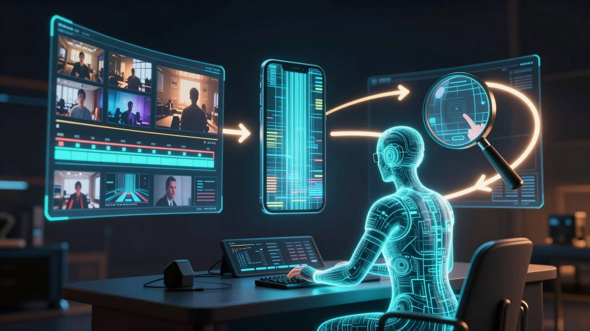
</div>

### The agent edits in a loop, like a human editor

ClipCannon is designed so the agent can **check its own work**:

1. **Understand.** `get_editing_context` → `get_scene_map` → `find_best_moments`
2. **Decide.** `find_safe_cuts` and `get_narrative_flow` to make sure every cut lands on a complete thought
3. **Draft.** `create_edit` with a declarative edit list (captions, face-tracking crop, split-screen, PIP, overlays, motion, color)
4. **Look.** `preview_layout` returns a single frame in about **300 ms**; `preview_clip` renders a 2–5 second 540p proof
5. **Inspect.** `inspect_render` samples the output at 0/25/50/75/100% and runs pass/fail checks
6. **Revise.** `apply_feedback` takes plain-language notes ("tighter opening, bigger captions"), `branch_edit` forks platform variants, `revert_edit` undoes
7. **Ship.** `render` to TikTok, Reels, Shorts, YouTube, 4K, Facebook, or LinkedIn with NVENC acceleration

---

## 📈 It gets better every time the AI gets smarter

<div align="center">
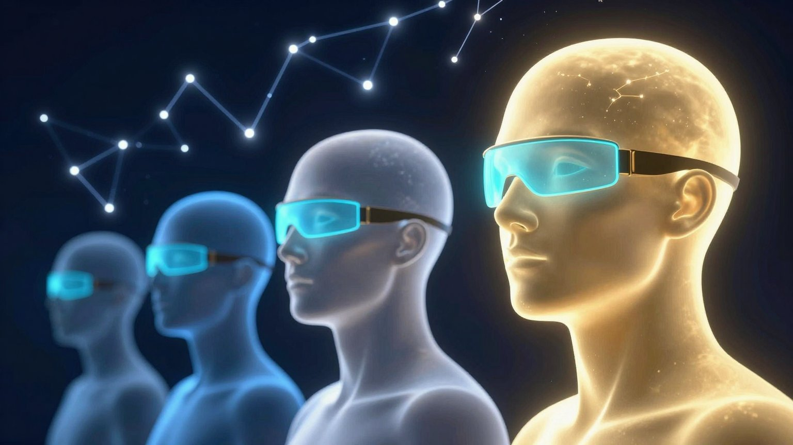
</div>

This is the part that makes ClipCannon a long-term bet rather than a feature.

ClipCannon is a **body, not a brain**. It doesn't make editorial decisions. It measures the footage and gives the agent precise instruments to act with. The judgment (what is funny, what is the hook, what story to tell, what to cut) comes from the model plugged into it.

So every time a better model ships, **ClipCannon gets better with no change to the code.** The measurements stay the same; what improves is how well the reasoner composes them. A model that can hold a two-hour scene map in its head, cross-reference emotional peaks against narrative beats, and plan a 10-clip series with callbacks will turn the same tools into much better edits.

Today's agents already cut usable highlight reels. Tomorrow's will produce work you'd expect from a skilled human editor, running on the same 58 tools.

---

## 🏭 The 23-stage pipeline

<div align="center">

</div>

One call to `clipcannon_ingest` runs a dependency-resolved DAG. Stages run in parallel where they can, optional stages degrade gracefully, and everything lands in a per-project SQLite database with sqlite-vec indexes.

| Group | Stages |
|---|---|
| **Foundation** | `probe` · `vfr_normalize` · `audio_extract` · `frame_extract` · `transcribe` (WhisperX large-v3) · `finalize` |
| **Seeing** | `visual_embed` (SigLIP) · `shot_type` · `ocr` (PaddleOCR v5) · `quality` (BRISQUE) · `scene_analysis` · `storyboard` |
| **Hearing** | `source_separation` (HTDemucs) · `speaker_embed` (WavLM) · `emotion_embed` · `prosody_analysis` · `reactions` (laughter, applause) · `acoustic` (beats, music vs. speech) |
| **Understanding** | `semantic_embed` (Nomic) · `narrative_llm` (Qwen3-8B: story beats, open loops, chapters) · `profanity` · `chronemic` (timing and pacing) |
| **Synthesis** | `highlights` (fuses emotion, reactions, semantics, visuals, quality, speaker, and pacing) |

---

## ✂️ Edit, caption, crop, render

<div align="center">
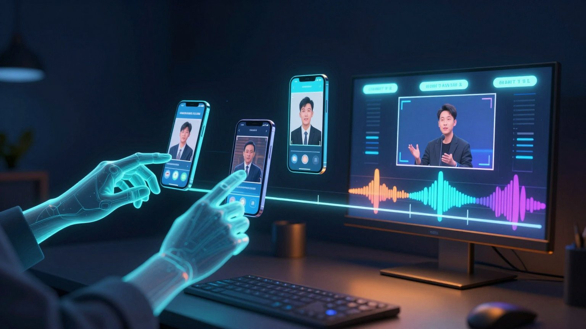
</div>

- **Declarative edit lists (EDL).** The agent describes the edit; the engine builds it. Every edit is versioned, with history, branches, and revert.
- **Adaptive captions** with word-level timing, **face-tracking smart crop** for vertical video, **split-screen**, **picture-in-picture**, canvas compositing, overlays and lower thirds, motion effects, and color adjustment.
- **Auto-trim** of filler words and dead air.
- **7 platform profiles:** TikTok, Instagram Reels, YouTube Shorts, YouTube, YouTube 4K, Facebook, and LinkedIn, rendered with FFmpeg and NVENC.
- **AI audio:** text-to-music with ACE-Step, MIDI composition with FluidSynth, DSP sound effects (whoosh, riser, impact, bass drop, shimmer, stinger…), speech-aware mixing with automatic ducking, and one-call cleanup (noise reduction, de-hum, de-ess, loudness normalization).

---

## 🎙️ Voice, measured and gated

<div align="center">
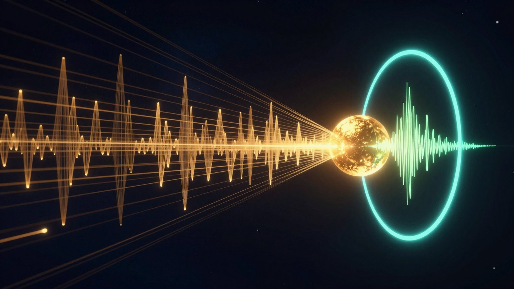
</div>

ClipCannon builds a voice profile from the speakers in your footage and speaks new lines in that voice. On sentences the speaker never said, it reaches a mean speaker similarity of **0.961** (max **0.975**) on Microsoft's WavLM speaker-verification model. That's inside the **0.95–0.99 "same person, same mic, same session"** band, where the verifier treats the clone the way it treats two real recordings from the same sitting.

The surprising part: **the TTS model is unmodified.** Every gain comes from pipeline engineering around Qwen3-TTS 1.7B:

| Step | What it does | Why it matters |
|---|---|---|
| **Full in-context learning** | Feeds a real microphone recording *and* its transcript, not just a speaker vector | Copies *how* the person speaks (accent, cadence, mic character, room tone), not only *who*. The single biggest gain in the ablation. |
| **50-clip centroid** | Averages the speaker's 50 best clips into one frozen target | +0.015 mean similarity over a single reference; less enrollment noise |
| **Best-of-N at T = 0.3** | Generates 12 candidates and keeps the closest to the centroid | A temperature sweep from 0.2 to 0.8 found 0.3 best for spectral consistency |
| **Score with the target encoder** | Selects candidates with the same encoder you measure with | Two encoders correlated only 0.51 on TTS audio; selecting with the wrong one made the target metric *worse* |
| **Three verification gates** | Sanity (duration, clipping, SNR, gaps) → intelligibility (Whisper WER) → identity (speaker similarity) | No take ships unless all three pass |
| **Resemble Enhance** | Removes codec artifacts and upsamples 24 kHz → 44.1 kHz | Broadcast-quality delivery |

Naturalness held up too. Microsoft's DNSMOS scored the clones **3.93** against **3.93** for the real recordings, and UTMOS scored them **3.012** against **2.997**.

The method is a **centroid plus a gate**: average many real clips into one frozen target, then accept a generated take only if it lands inside that region. It's the same idea the rest of the system is built on, applied to a voice.

> [!NOTE]
> **Read the numbers carefully.** The 0.961 is encoder-matched: candidates were selected and scored with the same WavLM model, on one English speaker and 10 held-out sentences. Published zero-shot systems (VALL-E 2 at 0.881, NaturalSpeech 3 at 0.891) clone strangers from one short clip with a single generation, which is a different and harder task. An independent ECAPA encoder scores the same clones lower. Full methodology: [the voice cloning paper](https://www.researchgate.net/publication/403213423_ClipCannon_0961_Mean_Cross-Encoder_Speaker_Similarity_via_Pipeline_Engineering_for_Personalized_Voice_Cloning).

---

## 🎯 Teleological Constellations: identity you can verify

How do you know a generated video of a person still *is* that person? Most generative systems can't answer that. They're trained to please a reward score and checked, at best, on a held-out set after the fact. ClipCannon's answer is **Teleological Constellation Training (TCT)**: define the identity as a frozen point in the seven-sense space, and hold every output to it.

<div align="center">
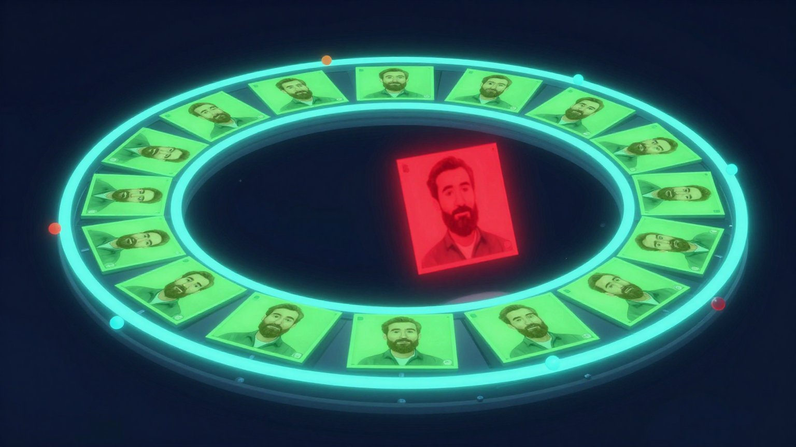
</div>

1. **Build the constellation.** Run reference footage through the frozen senses. For each one, average the normalized embeddings into a single frozen centroid. Together, the centroids *are* the identity.
2. **Train toward it.** A generator (or a best-of-N selector, when the model can't be fine-tuned) is pulled toward the centroids. The target never moves, so it can't drift.
3. **Guard every output.** At runtime, each generated frame or audio chunk is re-measured by the same frozen senses and must clear a threshold on **every** modality at once (default: visual 0.70, emotion 0.60, speaker 0.80, voice 0.85). A strong face can't make up for a wrong voice. Anything outside the region is rejected and regenerated.

That gives you something scalar-reward alignment doesn't: **per-output verification.** Each decision records the similarity score for every modality and the reason for any rejection, so you can check after the fact why a frame was allowed through. In testing, the visual guard scored reference frames at cosine 1.0 and rejected strangers' faces below 0.5.

Multi-sense audits also turned out to be a debugging tool. In the research behind ClipCannon they caught a training-data bug that made a model echo prompts in plain English, which a single-embedder check missed, and helped surface a flow-matching sign error that had a video model learning to *add* noise while its loss curve looked healthy.

### A vocabulary of expression, learned from the footage

<div align="center">
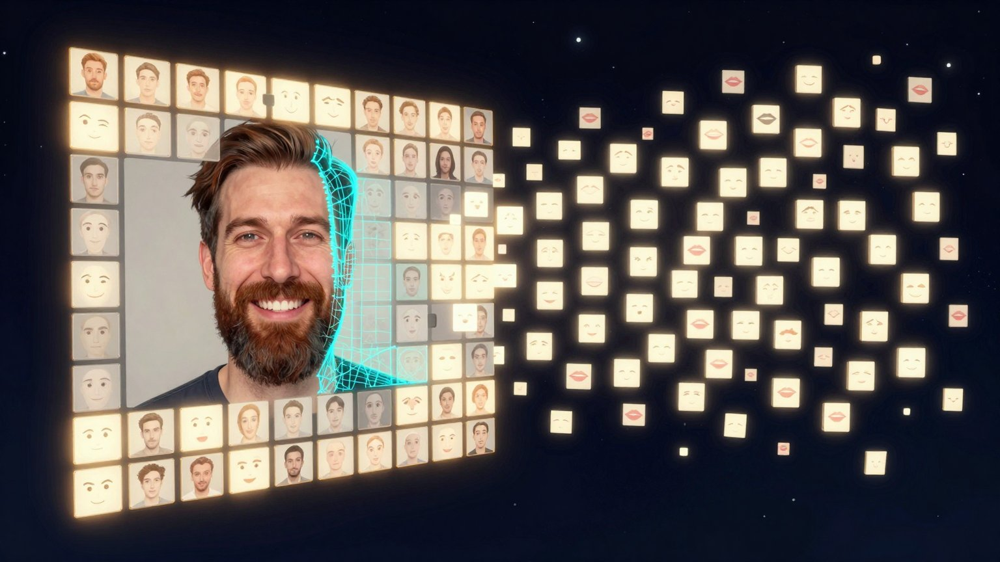
</div>

The constellation defines *who* the clone is. A four-level hierarchy, learned from the person's own footage, defines *what they can do*:

| Level | What it is | Learned from |
|---|---|---|
| **0 · Action units** | 17 facial muscle movements (FACS), such as `brow_raise`, `cheek_raise`, `lip_corner_pull` | FLAME 3D face fits, 100 expression coefficients per frame |
| **1 · Micro-expressions** | 40 groups: *this person's* recurring facial configurations, not generic ones | K-means over the FLAME coefficients |
| **2 · Skills** | 34 timed behaviors with onset, peak, and offset, such as `genuine_laugh`, `thoughtful_pause`, `warm_chuckle` | sequences of micro-expressions |
| **3 · Constellations** | 8 emotional states, such as `warm_conversational`, `happy_storytelling`, `solemn_gravity`, `gentle_humor` | cycling sequences of skills |

One call sets the emotional state, and the controller turns it into frame-by-frame expression conditioning, with smooth blends and transitions between states. No manual labeling at any level.

### Avatars and live meetings

- **Lip sync** (`lip_sync`): LatentSync 1.6 maps new audio onto a driver video of a speaker.
- **Script to video** (`generate_video`): text → cloned voice → lip-synced video in one call.
- **Expression control** (`list_constellations`, `list_skills`, `expression_sequence`, `clone_video`): browse the hierarchy, preview per-frame expression prompts, and generate a clone video of any trained identity with EchoMimicV3 and that person's LoRA. Every `clone_video` result goes through the constellation guard: sampled frames are re-embedded with frozen SigLIP, and the clip is rejected if any falls below the person's visual identity threshold. Per-identity trigger words and scene text live in `~/.clipcannon/models/<person>/clone.json`.
- **Phoenix avatar engine:** GPU-native rendering with CuPy CUDA kernels, FLAME face fitting at 82 fps, and a **PhysicsFaceEngine** that turns voice formants into mouth motion in under 5 ms, for any voice in any language, with no training.
- **Meeting bot:** an AI avatar that joins Google Meet (Teams and Zoom adapters included) using the Xvfb + Playwright + Insertable Streams architecture used by commercial meeting bots, listens, and replies in a cloned voice through a real-time ASR → LLM → TTS loop. The avatar answers to its own configured name. The companion Chrome extension has auto-join **off** by default, and the local bot server only accepts Google Meet links from the extension or local tools.
- **Voice agent ("Jarvis"):** a fully local conversational assistant with wake-word activation, streaming faster-whisper ASR, Silero VAD, a local Qwen3 LLM, and cloned-voice TTS.

> [!NOTE]
> **Status.** The voice result is measured. The constellation guard, expression hierarchy, and meeting pipeline are built and unit-tested (the guard alone has 22 tests). The guard now checks every `clone_video` output. Wiring it into the real-time meeting renderer and measuring end-to-end identity on talking-head video are next. Getting here took **17 approaches over six days**, from Gaussian splatting to CogVideoX to Hallo3. The white paper documents every one, including the 16 that failed.

> [!IMPORTANT]
> Clone only voices and faces you have the right to use. The research subject gave written consent, and the subject-specific voice and face artifacts are withheld on consent and dual-use grounds.

---

## 🔗 Every step is on the record

<div align="center">

</div>

Every pipeline operation is written to a **SHA-256 hash chain**. Each record hashes its parent, its input and output files, the operation, the model name and version, and the exact parameters. The chain starts from a `GENESIS` record, and verification recomputes every link, so any tampering with an analysis result or a render shows up. Files are hashed in streaming chunks, so multi-gigabyte sources work.

When an agent tells you *"this clip is the highest-energy moment"*, you can trace exactly which model, on which bytes, with which settings, produced that measurement.

---

## 🏠 Everything runs on your machine

<div align="center">
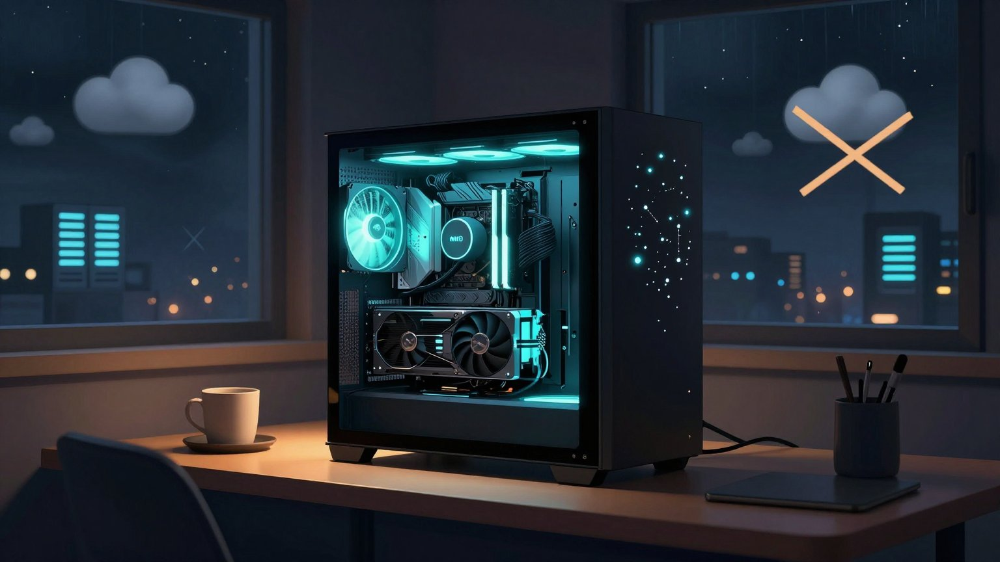
</div>

- **No cloud APIs.** Every model runs on your NVIDIA GPU. All data lives in SQLite on your disk.
- **Offline by default.** At runtime ClipCannon sets `HF_HUB_OFFLINE` / `TRANSFORMERS_OFFLINE` so nothing silently downloads. Models are fetched once, on purpose, with `scripts/download_models.py`.
- **Your footage never leaves the box.** That matters for client work, unreleased content, and anything with a face or voice in it.

---

## 🚀 Quick start

The fastest path is to let Claude Code install it for you.

```bash
git clone https://github.com/ChrisRoyse/clipcannon.git
cd clipcannon
claude
```

Then paste:

```text
Here is my Hugging Face token: hf_xxxxx

Please:
1. Install ClipCannon with all ML dependencies: pip install -e ".[ml,phase2]"
2. Set my HF token as an environment variable
3. Download the models once with scripts/download_models.py
4. Add ClipCannon as an MCP server
5. Verify the GPU is detected and the models load
6. Run the test suite
```

### Manual install

```bash
git clone https://github.com/ChrisRoyse/clipcannon.git
cd clipcannon

pip install -e .              # core: tools, editing, rendering
pip install -e ".[ml]"        # analysis pipeline, embeddings, voice
pip install -e ".[phase2]"    # AI audio, advanced voice, avatar
pip install -e ".[dev]"       # tests and linting

export HUGGINGFACE_TOKEN=hf_your_token_here
HF_HUB_OFFLINE=0 python scripts/download_models.py   # one-time fetch of the core analysis models
```

**Connect to Claude Code:**

```bash
claude mcp add clipcannon -- clipcannon
```

**Connect to Claude Desktop** (`claude_desktop_config.json`):

```json
{
  "mcpServers": {
    "clipcannon": { "command": "clipcannon", "args": [] }
  }
}
```

**Docker:**

```bash
cd config && docker compose up -d
# Dashboard: http://localhost:3200   License server: http://localhost:3100
```

**Voice agent ("Jarvis"):**

```bash
python -m voiceagent talk --voice <profile>              # local, wake-word activated
python -m voiceagent serve --voice <profile> --port 8765 # WebSocket server for remote clients
```

> [!TIP]
> On **WSL2**, audio capture needs a PulseAudio TCP bridge to Windows (port 4713). Ask your agent to set it up: *"I'm on WSL2. Set up a PulseAudio TCP bridge for ClipCannon audio capture."*

### Requirements

| | Minimum | Recommended |
|---|---|---|
| **GPU** | NVIDIA, 8 GB VRAM | 24–32 GB (RTX 4090 / 5090) |
| **CUDA** | 12.1+ | 13.0+ |
| **Python** | 3.12 | 3.13 |
| **FFmpeg** | 6.0+ | with NVENC |
| **RAM** | 16 GB | 64 GB+ |
| **Disk** | 20 GB | 50 GB+ |
| **OS** | Linux / WSL2 | Ubuntu 22.04+ or WSL2 on Windows 11 |

Models load on demand with LRU eviction: 24 GB+ cards run them concurrently, smaller cards load them in turn. GPU precision is auto-detected (bf16 on Blackwell).

---

## 💬 Things to ask your agent

```text
Create a project from ~/videos/podcast_ep42.mp4 and run the full analysis.
Then give me the editing context and the top 5 moments for a hook.
```

```text
Make five 60-second TikToks from the best moments. Face-tracking crop,
adaptive captions, cut only on complete thoughts. Preview each layout
before rendering and inspect every render.
```

```text
Find every moment where the guest gets excited about the product.
Build a 90-second YouTube Short that opens on the strongest one,
add upbeat background music that ducks under speech, and render it.
```

```text
Check the narrative flow of my edit. Did I cut away from any promise
before its payoff? Fix it and show me the diff.
```

```text
Build a voice profile from the host, then generate a 15-second intro
in their voice with the best-of-N optimizer.
```

```text
Analyze this meeting recording: transcript with speakers, key decisions,
action items, and a 3-minute highlight clip of the most important moments.
```

---

## 🧰 The 58 tools

Every tool is prefixed `clipcannon_`.

| Category | # | Tools |
|---|---|---|
| **Project** | 5 | `project_create` · `project_open` · `project_list` · `project_status` · `project_delete` |
| **Understanding** | 4 | `ingest` · `get_transcript` · `get_frame` · `search_content` |
| **Discovery** | 4 | `find_best_moments` · `find_cut_points` · `get_narrative_flow` · `find_safe_cuts` |
| **Editing** | 11 | `create_edit` · `modify_edit` · `auto_trim` · `color_adjust` · `add_motion` · `add_overlay` · `apply_feedback` · `branch_edit` · `list_branches` · `edit_history` · `revert_edit` |
| **Rendering** | 8 | `render` · `preview_clip` · `preview_segment` · `preview_layout` · `inspect_render` · `analyze_frame` · `get_editing_context` · `get_scene_map` |
| **Audio** | 6 | `generate_music` · `compose_music` · `compose_midi` · `generate_sfx` · `audio_cleanup` · `auto_music` |
| **Voice** | 4 | `prepare_voice_data` · `voice_profiles` · `speak` · `speak_optimized` |
| **Avatar** | 2 | `lip_sync` · `extract_webcam` |
| **Video generation** | 1 | `generate_video` |
| **Constellation** | 4 | `list_constellations` · `list_skills` · `expression_sequence` · `clone_video` |
| **Billing** | 4 | `credits_balance` · `credits_history` · `credits_estimate` · `spending_limit` |
| **Disk** | 2 | `disk_status` · `disk_cleanup` |
| **Config** | 3 | `config_get` · `config_set` · `config_list` |

Provenance verification is internal and not exposed as an MCP tool.

---

## 📊 Measured results

These figures come from ClipCannon's benchmark records and the research papers. They are author-measured and have not been independently replicated.

| Result | Value | Notes |
|---|---|---|
| Voice clone speaker similarity (WavLM SECS) | **0.961** mean, **0.975** max, 9 of 10 ≥ 0.95, 95% CI [0.951, 0.971] | Unmodified Qwen3-TTS, full ICL, 50-clip centroid, best-of-12 at T = 0.3; 10 held-out sentences, one English speaker; encoder-matched |
| Clone naturalness (DNSMOS P.808) | **3.93** clone vs **3.93** real | 14 samples |
| Clone naturalness (UTMOS) | **3.012** clone vs **2.997** real | 14 samples |
| SeedTTS-Eval test-en speaker similarity | **0.7785** mean over 1,088 samples | Reference points: human recordings 0.73, Seed-TTS DiT 0.79 |
| Derived data from one 16-minute interview | **12,000+** labeled data points, **3.1M** embedding values, **2,362** labeled training clips | 7 modalities × 4,044 dims plus FLAME expression |
| Expression vocabulary learned from that interview | **17** action units → **40** micro-expressions → **34** skills → **8** constellations | No manual labeling |
| Visual constellation guard | cosine **1.0** on reference frames; strangers rejected below **0.5** | SigLIP re-embedding |
| Face landmarks | **24,397** frames at ~**90%** detection, including a bearded subject | YOLOv5-Face |

> [!NOTE]
> An independent ECAPA speaker encoder scores the same clones lower than WavLM does, so read 0.961 as a within-encoder result. The raw benchmark JSON is in [`benchmarks/results/`](benchmarks/results/).

---

## 📚 Research

ClipCannon is documented in four papers:

| Paper | What it covers |
|---|---|
| [**ClipCannon and the Teleological Constellation System**](https://www.researchgate.net/publication/403734660_clipcannon_teleological_constellations_whitepaper) | The full white paper: architecture, the 23-stage pipeline, the constellation guard, the expression hierarchy, Phoenix, the meeting bot, and all 17 approaches to the clone-video problem |
| [**Teleological Constellation Training**](https://www.researchgate.net/publication/403916407_Teleological_Constellation_Training_Multi-Modal_Embedding_Decomposition_as_Meaning_Compression_for_Identity-Locked_Generation_and_a_Third_Path_Around_the_Data_Wall) | The formal method: Derived Data Abundance, meaning compression as a fourth kind of compression, the three-phase protocol, and the per-output guard, with three case studies |
| [**Derived Data Abundance**](https://www.researchgate.net/publication/403742763_Derived_Data_Abundance_How_Multi-Modal_Embedding_Decomposition_Solves_the_AI_Training_Data_Crisis_A_Research_Paper_on_Teleological_Constellation_Training_and_the_Data_Scaling_Wall) | How measuring existing data through many frozen embedders offers a path around the AI training-data wall without model collapse |
| [**0.961 Speaker Similarity via Pipeline Engineering**](https://www.researchgate.net/publication/403213423_ClipCannon_0961_Mean_Cross-Encoder_Speaker_Similarity_via_Pipeline_Engineering_for_Personalized_Voice_Cloning) | The voice cloning method and ablations: full ICL, 50-clip centroid, temperature sweep, and matched-encoder selection |

The same panel-of-frozen-senses approach also trained a [Shakespeare-style LoRA for Gemma 4](https://huggingface.co/cabdru/shakespeare-lora-gemma4) (using Context Graph's 13-instrument panel), which stays in character under prompt injection and, asked in Spanish, answers in Golden Age Spanish it was never trained on.

---

## 🏗️ Architecture

```text
              ┌────────────────────────────┐
              │  AI agent (MCP client)     │  Claude Code · Claude Desktop · any MCP host
              └─────────────┬──────────────┘
                            │ MCP (stdio)
              ┌─────────────▼──────────────┐
              │  ClipCannon MCP server     │  58 tools
              └─────────────┬──────────────┘
       ┌────────────────────┼─────────────────────┐
┌──────▼───────┐    ┌───────▼────────┐    ┌───────▼────────┐
│ Analysis     │    │ Editing +      │    │ Voice / Avatar │
│ 23-stage DAG │    │ Rendering      │    │                │
│ SigLIP       │    │ EDL engine     │    │ Qwen3-TTS      │
│ Nomic Embed  │    │ ASS captions   │    │ LatentSync     │
│ wav2vec2     │    │ smart crop     │    │ Phoenix (CuPy) │
│ WavLM        │    │ FFmpeg + NVENC │    │ MuseTalk       │
│ WhisperX     │    │ 7 profiles     │    │ Resemble Enh.  │
│ Qwen3-8B     │    │ ACE-Step audio │    │ voice agent    │
└──────┬───────┘    └───────┬────────┘    └───────┬────────┘
       └────────────────────┼─────────────────────┘
              ┌─────────────▼──────────────┐
              │ SQLite + sqlite-vec        │  per-project analysis.db
              │ SHA-256 provenance chain   │  4 vector spaces
              └────────────────────────────┘
```

<details>
<summary><strong>Models</strong></summary>

| Model | Role |
|---|---|
| SigLIP-SO400M | visual embeddings, shot type |
| Nomic Embed v1.5 | semantic embeddings |
| wav2vec2-large (MSP-dim) | dimensional speech emotion |
| WavLM-base-plus-sv | speaker embeddings, diarization |
| WhisperX large-v3 | transcription with word timestamps |
| faster-whisper large-v3-turbo | real-time ASR |
| HTDemucs v4 | source separation |
| PaddleOCR v5 | on-screen text |
| SenseVoiceSmall | laughter and applause |
| Qwen3-8B | narrative analysis (story beats, chapters) |
| Qwen3-TTS 1.7B / 0.6B | voice cloning / real-time TTS |
| Qwen3 voice embedding | voice identity verification |
| LatentSync 1.6 | lip sync (~18 GB VRAM) |
| MuseTalk 1.5 | real-time meeting avatar |
| ACE-Step v1.5 | text-to-music |
| insightface buffalo_l | face detection and landmarks |
| Silero VAD v5 | voice activity detection |

</details>

<details>
<summary><strong>Project layout</strong></summary>

```text
src/
  clipcannon/      MCP server, 23-stage pipeline, editing, rendering, audio, voice, provenance, dashboard
  phoenix/         GPU-native avatar engine: render, expression, behavior, video constellations
  voiceagent/      real-time voice assistant and meeting bot (Meet, Teams, Zoom)
  license_server/  credit billing service
  chrome_extension/ companion extension for the Google Meet bot
scripts/           model download, GPU validation, bot launchers
benchmarks/        voice benchmark scripts and raw results
tests/             1,300+ tests
config/            Docker Compose and default config
```

</details>

<details>
<summary><strong>Configuration</strong></summary>

Config lives at `~/.clipcannon/config.json` and can be changed by the agent through `config_set`:

```text
processing.whisper_model      = "large-v3"
processing.frame_extraction_fps = 2
rendering.use_nvenc           = true
gpu.device                    = "cuda:0"
gpu.max_vram_usage_gb         = 24
```

</details>

---

## ❓ FAQ

**How much VRAM do I need?** 8 GB runs the core analysis one model at a time. 16 GB is comfortable for analysis, editing, and basic voice work. 24 GB runs the full pipeline with voice cloning. 32 GB runs everything concurrently, including the real-time meeting bot.

**Can I run it without a GPU?** The analysis pipeline needs CUDA. Editing and rendering work on CPU but are much slower without NVENC.

**Mac / Apple Silicon?** Not yet. The stack depends on CUDA, PyTorch CUDA, and NVENC.

**How long does analysis take?** Roughly 2–3 minutes for a 5-minute video and 15–20 minutes for an hour on an RTX 4090. The DAG runs stages in parallel, so faster GPUs finish sooner.

**Is my data sent anywhere?** No. Runtime is offline by default; the only network access is the one-time model download you run on purpose.

**Which agents work with it?** Any MCP client. It's developed with Claude Code and Claude Desktop.

---

## 🧪 Testing

```bash
pytest                      # full suite
pytest tests/phoenix/       # avatar engine (GPU)
pytest tests/voiceagent/    # voice agent
pytest tests/integration/   # needs GPU + a test video
ruff check src/
```

**Formats:** mp4, mov, mkv, webm, avi, ts, mts in; platform-optimized mp4 (h264/h265) out.

---

## 🌌 The family

ClipCannon is one of several systems built on the same idea: **meaning is measured, not guessed.**

| Project | What it is |
|---|---|
| [**Calyx**](https://github.com/ChrisRoyse/Calyx) | An association-native database: constellations as the native record, grounding kernels, fail-closed guards, a tamper-evident ledger |
| [**Synapse**](https://github.com/ChrisRoyse/Synapse) | A real body for your AI on Windows: it sees the screen, moves the mouse, and runs 24/7 |
| [**Context Graph**](https://github.com/ChrisRoyse/contextgraph) | 13 frozen instruments over text and code memory |
| [**JIK**](https://github.com/ChrisRoyse/JIK) | A meaning-native language model that predicts the next constellation, not the next token |

---

## 🤝 Contributing

1. Fork the repo and create a branch (`git checkout -b feature/my-feature`)
2. Add tests for new behavior
3. Make sure `pytest` passes and `ruff check src/` is clean
4. Open a pull request

---

## 📜 License

[Business Source License 1.1](LICENSE) © 2026 Chris Royse.

You can use, modify, and self-host ClipCannon freely. The one restriction: you can't use it to offer a competing commercial video production service to third parties. On **2030-03-31** (or four years after each version's release), the license converts to **Apache 2.0**.

---

## 💛 Support ClipCannon

ClipCannon is built and maintained by one developer. If it's useful to you, please consider supporting it.

<p align="center">
  <a href="https://www.paypal.com/paypalme/ChrisRoyseAI"></a>
</p>

---

<p align="center">
  <em>Your AI can read. Now let it watch.</em><br>
  <strong>⭐ Star the repo if ClipCannon is useful to you.</strong>
</p>

<p align="center">
  📫 <strong>Contact:</strong> <a href="mailto:chrisroyseai@gmail.com">chrisroyseai@gmail.com</a> · 🌐 <a href="https://www.clipcannon.com">clipcannon.com</a>
</p>
